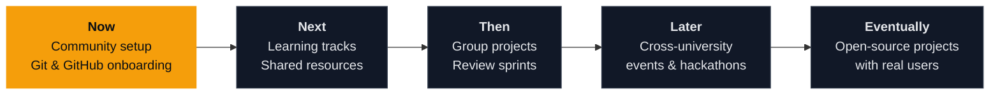

<div align="center">


<a href="https://github.com/The-Bachelors/Community">
  
</a>

<br/>

<a href="https://github.com/The-Bachelors/Community"></a>
<a href="https://github.com/The-Bachelors/Community/issues"></a>
<a href="https://github.com/The-Bachelors/Community/pulls"></a>


</div>

<br/>

## `$ whoami`

**We're undergrads from different universities who got tired of learning alone.**

The Bachelors is a place to write real code with real people: open a branch, get a review, fix it, merge it, repeat. It doesn't matter which campus you're on, what you're majoring in, or how many `git` commands you remember. If you're curious and willing to ship, you belong here.

<table>
<tr>
<td width="33%" valign="top">

**Learn in public**<br/>
<sub>Questions, half-finished ideas and mistakes all belong in the open. That's how everyone gets better faster.</sub>

</td>
<td width="33%" valign="top">

**Review with kindness**<br/>
<sub>Feedback is how we grow. We critique the code, never the person who wrote it.</sub>

</td>
<td width="33%" valign="top">

**Ship small, ship often**<br/>
<sub>A tiny merged pull request beats a perfect one that never leaves your laptop.</sub>

</td>
</tr>
</table>


## `$ git log --community`

A typical week around here, roughly:

```text
a3f9c21  Mon  docs: new members introduce themselves
7be10d4  Tue  feat: someone adds a sorting visualizer nobody asked for
c92e5a8  Wed  fix: three people spot the same off-by-one, politely
51d8b07  Thu  review: "nice approach, have you considered a hashmap?"
e04f7a3  Fri  merge: first-ever contribution from a student at a new university
```

<sub>Illustrative, but this is the rhythm we're building toward.</sub>


## `$ ./join.sh`

Your first contribution takes about ten minutes.

```bash
# 1. Fork the Community repo on GitHub, then clone your fork
git clone https://github.com/<your-username>/Community.git
cd Community

# 2. Work on a branch, never on main
git checkout -b your-name/what-you-are-doing

# 3. Make your change, then save it
git add .
git commit -m "docs: add my introduction"

# 4. Push it up
git push origin your-name/what-you-are-doing
```

Then open GitHub, click **Compare & pull request**, give it a clear title, and submit. A teammate will review it, and once it's approved, it's merged. That's the whole loop.

<details>
<summary><b>Something went wrong?</b></summary>
<br/>

| Problem | Likely fix |
|:--|:--|
| `Permission denied` on push | You cloned the main repo instead of your fork. Re-clone your fork. |
| Merge conflict | Pull the latest `main`, resolve the marked lines, commit again. |
| Committed to `main` by accident | Stop, don't push. Ask for help in an issue first. |
| Totally lost | Open an issue titled `need help`. Someone will pick it up. |

</details>


## `$ ls ways-to-contribute/`

| | What it looks like | Good for |
|:--|:--|:--|
| **Write** | Notes, guides, cheat sheets, code examples | Anyone, especially beginners |
| **Build** | Small projects and experiments, solo or in teams | Learning by doing |
| **Review** | Reading pull requests and leaving thoughtful feedback | Sharpening your eye for clean code |
| **Mentor** | Helping newer members through their first Git workflow | Teaching to learn deeper |
| **Propose** | Opening issues with ideas, bugs and improvements | Shaping where we go next |


## `$ cat roadmap.md`




## `$ cat toolbox.txt`

<div align="center">


</div>

<br/>


## `$ cat CODE_OF_CONDUCT.md`

| We do | We don't |
|:--|:--|
| Create a branch for every change | Push directly to `main` |
| Write clear commit messages | Merge our own PR without a review |
| Ask questions, however basic | Present other people's work as our own |
| Give feedback that's specific and kind | Mock, belittle, or harass anyone |
| Celebrate each other's progress | Leave `final_v2_REAL.cpp` in the repo |

**Commit format:** `feat:` new things · `docs:` notes and docs · `fix:` bug fixes · `style:` formatting only


## `$ man faq`

<details>
<summary><b>Do I need to be good at coding?</b></summary>
<br/>
No. Curiosity matters more than experience. Everyone here started at zero.
</details>

<details>
<summary><b>I'm from a different university than most people. Is that okay?</b></summary>
<br/>
That's the whole idea. More campuses means more perspectives.
</details>

<details>
<summary><b>What if I break something?</b></summary>
<br/>
You won't. Every change lives on a branch and goes through review before it touches <code>main</code>.
</details>

<details>
<summary><b>Can I bring my own project?</b></summary>
<br/>
Please do. Open an issue, describe it, and see who wants to build it with you.
</details>

<br/>

<div align="center">

<a href="https://github.com/The-Bachelors/Community">
  
</a>

<br/><br/>

<sub>Star the repo &nbsp;·&nbsp; fork it &nbsp;·&nbsp; tell a friend from your university</sub>

<br/>


</div>
