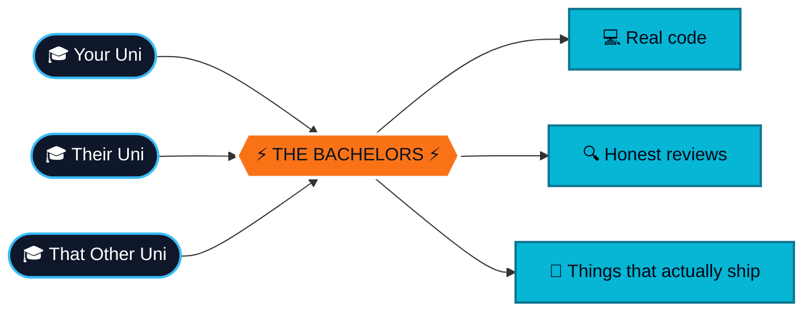
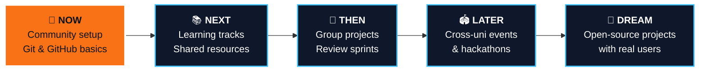

<div align="center">


<a href="https://github.com/The-Bachelors/Community">
  
</a>

<br/><br/>

<a href="https://github.com/The-Bachelors/Community"></a>
<a href="https://github.com/The-Bachelors/Community/issues"></a>
<a href="https://github.com/The-Bachelors/Community/pulls"></a>


</div>

<br/>

<div align="center">

# Learn it. Break it. Fix it. Ship it.

**We're students from different universities who decided learning to code shouldn't be a solo sport.**<br/>
Build real things with real people, and get better faster than you ever would alone.

</div>


<div align="center">

## 🌍 How it works

</div>




<div align="center">

## 🥊 Learning solo vs. learning here

</div>

<div align="center">

| 😵‍💫 Going it alone | 😎 With the squad |
|:--|:--|
| 47 open tabs, zero progress | One focused pull request |
| Stuck on a bug for 3 hours | Someone spots it in 3 minutes |
| "Am I even doing this right?" | A real review that tells you |
| Tutorials you never finish | Projects you actually ship |
| Learning inside your own bubble | Ideas from a dozen campuses |

</div>


<div align="center">

## 🗣️ Git, translated to human

</div>

<div align="center">

| Command | What it really means |
|:--|:--|
| `git clone` | Download the whole project to your laptop |
| `git checkout -b` | Open your own private sandbox |
| `git add` + `git commit` | Save your progress, with a note to future you |
| `git push` | Send it to the cloud. Let's go. |
| `pull request` | "Hey team, can someone look at this?" |
| `code review` | Sharp eyes making your code better |
| `merge` | It's official. You built that. 🎉 |

</div>


<div align="center">

## ⚡ Your first contribution in 4 moves

</div>

```bash
# 🍴 MOVE 1: fork the Community repo on GitHub, then clone YOUR fork
git clone https://github.com/<your-username>/Community.git
cd Community

# 🌿 MOVE 2: make your own branch (main is off-limits)
git checkout -b your-name/what-you-are-doing

# ✍️ MOVE 3: do your thing, then save it
git add .
git commit -m "docs: add my intro 👋"

# 🚀 MOVE 4: send it
git push origin your-name/what-you-are-doing
```

Now open GitHub, hit **Compare & pull request**, give it a clear title, and submit. A teammate reviews it, you tweak if needed, it gets merged. **Combo complete.** 💥

<details>
<summary><b>🆘 Stuck? Open this first</b></summary>
<br/>

| Problem | What to do |
|:--|:--|
| `Permission denied` when pushing | You cloned the main repo, not your fork. Re-clone your fork. |
| Merge conflict | Pull the latest `main`, fix the marked lines, commit again. |
| Committed to `main` by mistake | Don't push. Ask for help in an issue first. |
| Completely lost | Open an issue called `help me pls`. Someone will come get you. |

</details>


<div align="center">

## 🛤️ Pick a track

<sub>Where we're building our learning paths. Join one, or build your own.</sub>

</div>

<div align="center">

| Track | Vibe | Status |
|:--|:--|:--|
| 🧱 **Git & GitHub** | Branches, PRs, reviews. The foundation for everything else. |  |
| ⚙️ **C++ & OOP** | Strong fundamentals, clean classes, real exercises |  |
| 🧮 **Data Structures & Algorithms** | Arrays, lists, trees, and thinking like a problem-solver |  |
| 🐍 **Python** | Scripts, automation, and the gateway to data and AI |  |
| 🤖 **AI & ML** | Models, data, and building things that learn |  |
| 🌐 **Web Dev** | HTML, CSS, JS, and shipping something people can click |  |

</div>


<div align="center">

## 🏆 Achievements to unlock


<br/>


<br/>


<sub>No real prizes. Just bragging rights.</sub>

</div>


<div align="center">

## 🧭 Find your lane

</div>

<table>
<tr>
<td width="20%" align="center" valign="top">

### ✍️<br/>Write
<sub>Notes, guides, cheat sheets and code examples</sub>

</td>
<td width="20%" align="center" valign="top">

### 🔨<br/>Build
<sub>Small projects and experiments, solo or in teams</sub>

</td>
<td width="20%" align="center" valign="top">

### 🔍<br/>Review
<sub>Read pull requests and leave thoughtful feedback</sub>

</td>
<td width="20%" align="center" valign="top">

### 🧙<br/>Mentor
<sub>Guide newer members through their first workflow</sub>

</td>
<td width="20%" align="center" valign="top">

### 💡<br/>Propose
<sub>Open issues with ideas, bugs and improvements</sub>

</td>
</tr>
</table>

<div align="center"><sub>Plot twist: you'll end up doing all five.</sub></div>


<div align="center">

## 🗺️ Where we're headed

</div>




<div align="center">

## 🧰 What we play with


<sub>...and whatever shiny new tool someone convinces us to try next</sub>

</div>


<div align="center">

## 📜 House rules

</div>

<table>
<tr>
<td width="50%" valign="top">

### ✅ Please do
- 🌿 Branch before you build
- 💬 Write commit messages humans can read
- 🤗 Keep reviews kind and specific
- 🙋 Ask questions, all of them
- 🎉 Hype up your teammates
- 🔄 Pull `main` before starting new work

</td>
<td width="50%" valign="top">

### 🚫 Please don't
- ⛔ Push straight to `main`
- ⛔ Merge your own PR without a review
- ⛔ Pass off someone else's work as yours
- ⛔ Mock people for their code (or anything)
- ⛔ Leave `final_v2_REAL_final.cpp` lying around
- ⛔ Be a jerk. Just no.

</td>
</tr>
</table>

<div align="center">

**Commit prefixes:** &nbsp;`feat:` new stuff &nbsp;•&nbsp; `docs:` notes &nbsp;•&nbsp; `fix:` bug squashed &nbsp;•&nbsp; `style:` formatting only

</div>


<div align="center">

## 👥 The squad

<a href="https://github.com/The-Bachelors/Community/graphs/contributors">
  
</a>

<sub>Every face here shipped something. Yours could be next.</sub>

</div>


<div align="center">

## 🤔 Questions you're probably thinking

</div>

<details>
<summary><b>Do I need to be good at coding?</b></summary>
<br/>
Nope. Curiosity beats experience. Everyone here started at zero.
</details>

<details>
<summary><b>I'm from a different university than everyone else. Okay?</b></summary>
<br/>
That's literally the point. More campuses, more perspectives, better ideas.
</details>

<details>
<summary><b>What if I break something?</b></summary>
<br/>
You can't. Every change lives on a branch and gets reviewed before it ever touches <code>main</code>.
</details>

<details>
<summary><b>Can I bring my own project idea?</b></summary>
<br/>
Please do. Open an issue, pitch it, and see who wants in.
</details>

<br/>

<div align="center">

<a href="https://github.com/The-Bachelors/Community">
  
</a>

<br/><br/>

⭐ **Star the repo** &nbsp;•&nbsp; 🍴 **Fork it** &nbsp;•&nbsp; 📣 **Tell a friend from your uni**

<br/>


</div>
